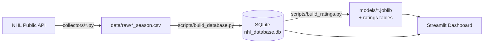

# Hockey AI Analytics Platform

An end-to-end NHL analytics pipeline: pulls real data from the NHL's public API, stores it
in a validated SQLite database, rates every team and skater with machine-learning
models, and presents it through an interactive Streamlit dashboard.

Built incrementally, phase by phase, with an emphasis on **honesty over polish** where the
two conflict — every scope limitation in this project
is documented in place rather than hidden, including in this README.

> Want to see it running? `streamlit run dashboard/Home.py` after setup below —
> screenshots aren't embedded here yet, but the app is a couple of commands away.

## What it does

- **Collects** real NHL standings, schedules, team stats, and player stats from the
  NHL's public (unofficial, keyless) API
- **Stores** everything in SQLite with real primary keys, foreign keys, and validation
  (row counts, null checks, duplicate checks, referential integrity)
- **Rates** every team and skater with scikit-learn pipelines: who's overrated,
  underrated, and playing better or worse lately (see [Model ratings](#model-ratings))
- **Visualizes** standings, team form trends, model ratings, player leaderboards, and each
  team's season games in a multi-page Streamlit + Plotly dashboard

## Architecture



Each stage is a separate, independently-runnable script — the pipeline is meant to be
inspected and rerun stage by stage, not treated as one opaque process.

## Tech stack

| Layer | Tool |
|---|---|
| Data collection | `requests` + `pandas` |
| Storage | SQLite (raw `sqlite3`, no ORM) |
| Feature engineering | `pandas` (rolling/expanding windows) |
| ML | `scikit-learn`, `xgboost` |
| Dashboard | `streamlit` + `plotly` |
| Testing | `pytest` |

No LLM, no API keys, no cloud services, no paid dependencies anywhere in this stack —
everything here runs entirely locally for free.

## Project structure

```
collectors/          NHL API -> data/raw/<dataset>_<season>.csv (one script per data type)
src/api/              HTTP client + endpoint wrappers for the NHL API
src/database/         SQLite schema, import/upsert logic, queries, validation
src/features/         Leakage-safe rolling team-form calculations (used by the Team page)
src/models/           Team and player ratings models (scikit-learn pipelines)
scripts/              Runnable entrypoints that tie src/ modules together
dashboard/            Streamlit multi-page app
tests/                pytest suite
database/schema.sql   Table definitions (source of truth for the DB structure)
data/raw/             Collector output (gitignored, regenerate anytime)
models/               Trained models (*.joblib, gitignored) + evaluation reports (*_report.json)
```

## Getting started

Requires Python 3.12+ (developed and tested on 3.12.6).

```
git clone <this-repo>
cd "Hockey AI Analytics Platform"
python -m venv venv
venv\Scripts\python.exe -m pip install -r requirements.txt
```

No `.env` file or API key is needed — the NHL's public API requires no authentication.

## Running the pipeline

Run these in order. Each is idempotent — rerunning any step is always safe.

```
# 1. Pull fresh data from the NHL API into data/raw/<dataset>_<season>.csv
#    (past seasons are fetched once and then skipped; delete a file to re-fetch it)
venv\Scripts\python.exe collectors\collect_teams.py
venv\Scripts\python.exe collectors\collect_players.py
venv\Scripts\python.exe collectors\collect_games.py
venv\Scripts\python.exe collectors\collect_player_games.py

# 2. Build/update the SQLite database from those CSVs, with validation
venv\Scripts\python.exe scripts\build_database.py

# 3. Rate teams and players (trains the models first if none are saved yet;
#    add --retrain after adding a season or changing a model's features)
venv\Scripts\python.exe scripts\build_ratings.py

# 4. Launch the dashboard
venv\Scripts\python.exe -m streamlit run dashboard\Home.py
```

The dashboard also has a "Refresh all data" button that reruns steps 1-3 for you (scoring
with the saved models -- it doesn't retrain).

## Hosting

The dashboard can run on Streamlit Community Cloud straight from this repo (main file
`dashboard/Home.py`, Python 3.12). The database and the two trained models are committed
for that reason. The hosted copy is read-only: set the secret `SESPN_READ_ONLY = "true"`
to hide the Refresh button. Update it by refreshing locally and pushing.

## Model ratings

Two models answer "how good is this team/player really?" by predicting the future from
the present -- the prediction is the **expected** number, with hot and cold streaks
squeezed out:

| Model | Predicts | From (season so far) |
|---|---|---|
| Team (`src/models/team_ratings.py`) | Points % over the rest of the season | Shot, shot-attempt and goal share, shooting and save %, special teams, last season's points % |
| Player (`src/models/player_ratings.py`) | Points per game over the next 20 games | Ice time (all, power play, shorthanded), shots, shooting %, scoring, position, last season's scoring |

Comparing expected with actual gives the dashboard's verdicts: **overrated / underrated**
(standings or points rank far from the model's rank) and **playing better / worse** (the
model's rating of the last 10 games vs the whole season).

How they're built (`src/models/pipelines.py`): every candidate is a scikit-learn
`Pipeline` (impute -> scale -> one-hot -> model). The most recent completed season is held
out as the test set; hyperparameters are tuned by cross-validation on the earlier seasons,
one season per fold. The winner is picked by cross-validation score, never test score.
Results on the held-out 2025-26 season:

| | Team R² | Player R² |
|---|---|---|
| League average (baseline) | -0.01 | 0.00 |
| Current results only (baseline) | 0.05 | 0.54 |
| **Ridge regression (chosen)** | **0.19** | **0.66** |
| Random forest | 0.14 | 0.66 |
| XGBoost | 0.24 | 0.66 |

XGBoost scored best on the team test season, but Ridge won cross-validation, so Ridge is
used -- choosing by test score would quietly turn the test set into training data.
Findings along the way, kept in the module docstrings: a 20-game team target was too
noisy for any model to beat the league average, and features weighted by games played
were needed so early-season hot streaks aren't over-trusted.

## Testing

```
venv\Scripts\python.exe -m pytest tests\ -v
```

19 tests covering: database upsert idempotency and foreign key enforcement, queries,
the leakage-safe rolling team-form logic (including the offseason season-boundary
edge case), and the ratings models' snapshots (features only from games already played,
targets only from games after), relocated-franchise carryover, and verdicts.

## Data source & honest limitations

Data comes from the NHL's public API (`api-web.nhle.com`) — free, no key required, but
**unofficial and undocumented**. Field names in this codebase were verified against live
responses (see `scripts/explore_api.py`), not assumed from documentation that doesn't
exist. If the NHL changes something, collectors are designed to fail loudly rather than
silently return bad data.

Known, deliberate scope limitations (not bugs):

- **Four seasons are collected:** the current one (`CURRENT_SEASON` in
  `src/utils/constants.py`) and three past seasons (`HISTORICAL_SEASONS`), which are the
  models' training and test history. A toggle in the top-right of every dashboard page
  switches all views between the current season and last season; past seasons show final
  standings.
- **No starting-goalie data.** The NHL's box-score endpoints don't expose which goalie
  started a game without a separate boxscore/gamecenter collector this project doesn't
  build. Team-level rolling goals-against is used as an imperfect proxy.
- **Goalies aren't rated** -- the player model covers skaters only.
- **The NHL API rate-limits bursts of requests.** The client waits out "429 Too Many
  Requests" responses rather than skipping data, so a full first-time collection takes a
  few minutes.
- **No AI/LLM layer.** The original project concept included one; it was deliberately
  cut early on to avoid ongoing API costs and keep this fully free to run.

## Possible future work

- Game-outcome prediction for upcoming games, built on the team ratings
- A starting-goalie collector (via NHL boxscore/gamecenter endpoints) to unlock real
  goalie-specific features
- Advanced analytics: shot maps, an expected-goals (xG) model, player similarity
  clustering — all deferred since they need shot-coordinate data not yet collected
- A scheduled task (e.g. Windows Task Scheduler running the pipeline daily, with a weekly
  `build_ratings.py --retrain`) to keep everything current automatically during a season

## About this project

A hockey analytics platform built end-to-end in Python: NHL API data collection, SQLite
storage with real validation, and an interactive Streamlit dashboard — built incrementally with tests at every stage
and honest reporting of what does and doesn't work well.
